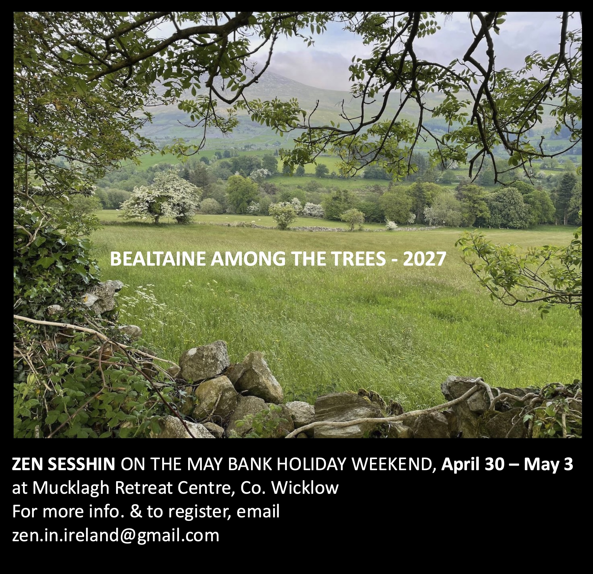

This Zen Retreat will be an opportunity for a deep and peaceful weekend of practice, at Mucklagh Lodge Retreat Centre in south Wicklow. In silence and with dedicated attention to the present moment, we will do the important work of repairing our sense of disconnection - within ourselves and from the natural world -. Whether sitting zazen at dawn, or connecting deeply with the land by meditative walking through the trees, we come to realise how integrated with Earth we are. Like the ‘wood-wide web’ discovered by the forest scientist Suzanne Simard, we sit among the trees and nourish each other in an extraordinary system of mutuality and exchange.

Cost: €300. Registration opens Dec. 1st , and closes, Feb. 28th

Early bird: €250 to be paid in full before Dec. 15th

For more information, contact Mary Soshin Laheen at zen.in.ireland\@gmail.com

